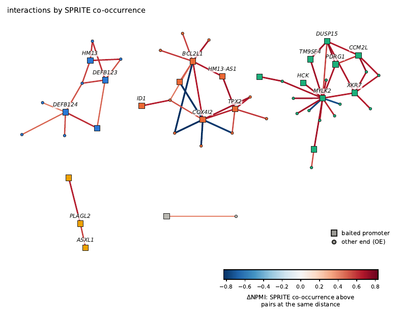
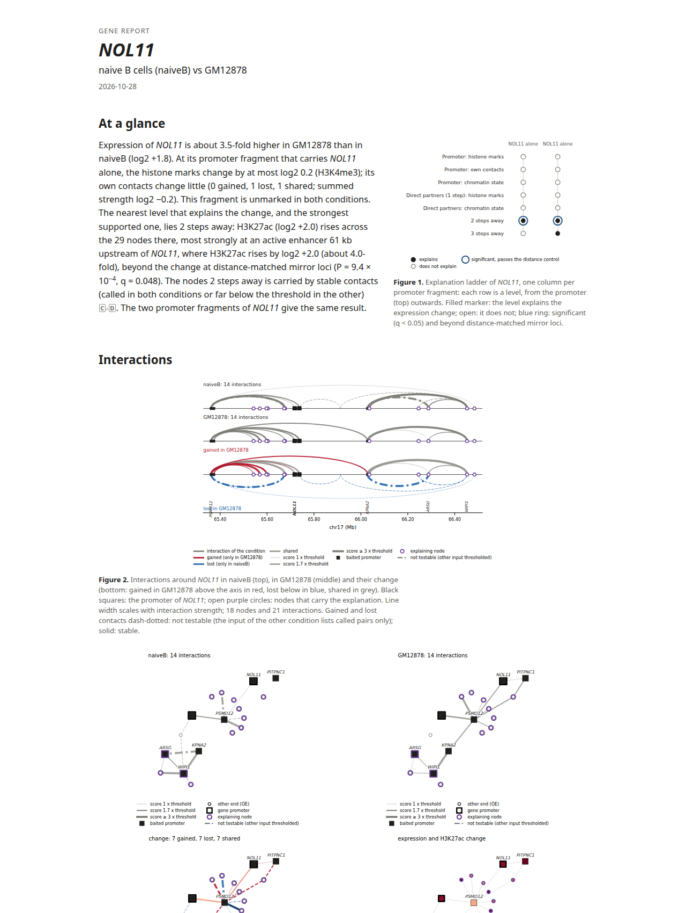
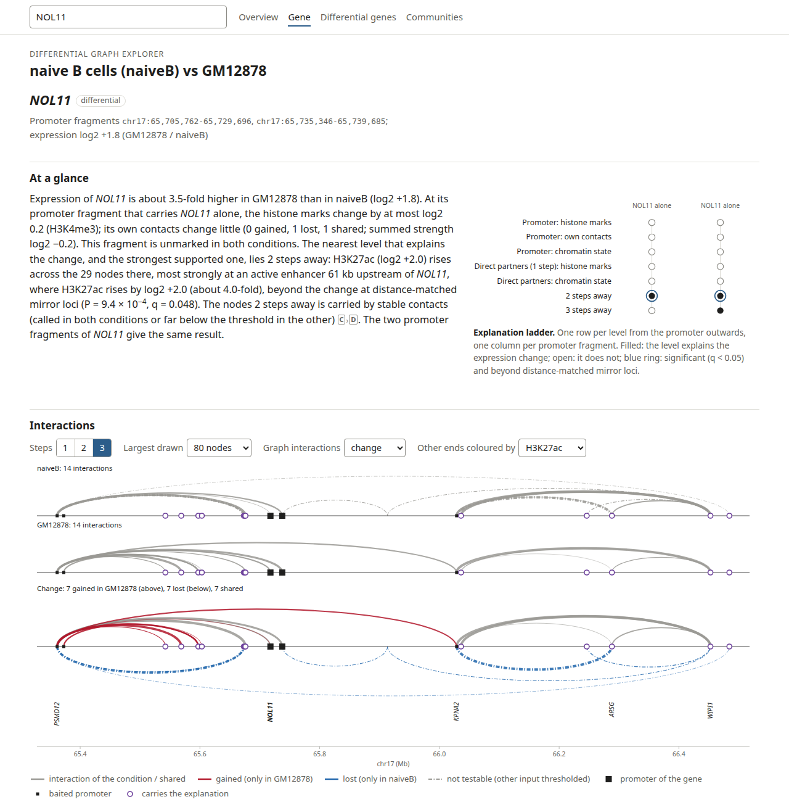
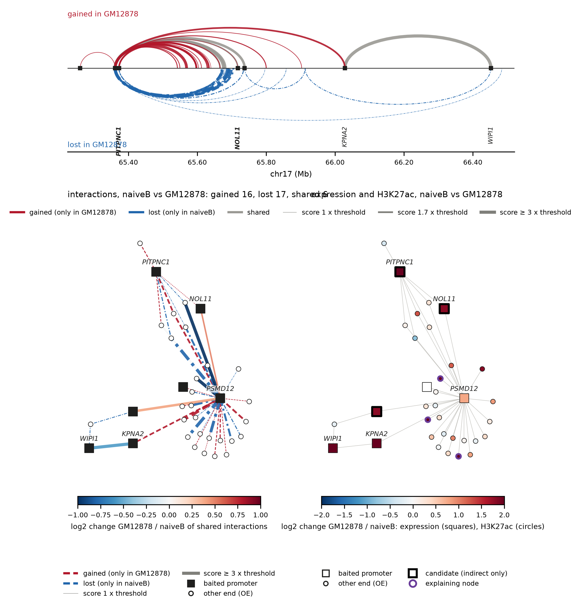

# Case study from A to Z: naive B cells against GM12878

This case study runs EGA on public data from the download to the calibration. It compares naive B cells with the
B-lymphoblastoid line GM12878, the comparison of the manuscript in which GM12878 multi-way data test the candidate
paths. Every command below is part of two scripts in the repository, and every number and figure on this page comes
from running them.

```bash
bash example/case_study/download.sh data         # about 14 GB of public inputs
bash example/case_study/run.sh data output 12    # about 45 minutes on 12 cores, at most 8.3 GB of memory
```

## Inputs

`download.sh` fetches:

| Input | Source |
|---|---|
| GM12878 CHiCAGO calls | GEO GSE81503 (Cairns et al. 2016) |
| hg19 HindIII capture design (`.rmap`, `.baitmap`) | OSF [osf.io/u8tzp](https://osf.io/u8tzp) (Javierre et al. 2016) |
| naive B cell calls and the DESeq2 table of the comparison | Zenodo [10.5281/zenodo.23725671](https://doi.org/10.5281/zenodo.23725671), record 03 |
| H3K27ac, H3K4me1, H3K4me3, H3K27me3 of B cells (E032) and GM12878 (E116) | Roadmap Epigenomics, fold change over input |
| gene annotation | GENCODE v19 |
| GM12878 SPRITE clusters | GEO GSE114242 (Quinodoz et al. 2018) |

## 1. The graph of GM12878

```bash
egaCreateGraph -i GSE81503_GM12878_PCHiC_merge_final_washU_text.txt.gz -f washu \
    --baits Human_hg19/Digest_Human_HindIII_baits_e75_ID.baitmap --scoreThreshold 5 \
    --tss gencode.v19.annotation.gtf.gz --maxDistance 2000000 --weight score --communityMethod leiden \
    --resolution 1.0 --seed 42 -o graphs/GM12878
egaIndirectContacts -g graphs/GM12878.graphml --maxDistance 2000000 --triplets -o graphs/GM12878
```

The graph holds 56,449 fragments and 88,124 interactions (`graphs/GM12878_nodes.tsv`, `_edges.tsv`). Through shared
neighbours, it connects 621,099 further pairs at two steps (`graphs/GM12878_indirect.tsv`). Of these, 395,210 are
pairs of two other ends, which promoter capture never measures.

## 2. Do graph neighbours occur together in single nuclei?

SPRITE clusters are assigned to the HindIII fragments of the capture design, and every pair of the graph is compared
with ten control pairs at the same distance and coverage that are not connected in the graph. Up to 300,000 pairs
of each kind are tested.

```bash
awk 'BEGIN{OFS="\t"} {print "chr"$1, $2, $3}' Human_hg19/Digest_Human_HindIII.rmap > hg19_HindIII_fragments.bed
awk 'BEGIN{OFS="\t"} {if ($3 > end[$1]) end[$1] = $3} END{for (c in end) print c, end[c]}' \
    hg19_HindIII_fragments.bed > hg19.chrom.sizes
egaBuildMultiway --type sprite --input sprite/human.combined.mapq-ge30.clusters --chromSizes hg19.chrom.sizes \
    --fragments hg19_HindIII_fragments.bed -o multiway/GM12878_sprite.npz
egaValidateMultiway -g graphs/GM12878.graphml -m multiway/GM12878_sprite.npz --confirmPairs \
    --coverageClasses 5 --controls 10 --maxPairs 300000 --maxTriplets 100000 --seed 0 --threads 12 \
    -o validation/GM12878_sprite
```

`validation/GM12878_sprite_summary.tsv` gives, for every kind of pair, the share of pairs that occur together in
SPRITE more often than their controls (0.5 means no difference):

| Pairs | Number | Above their controls |
|---|---|---|
| measured interactions (one step) | 87,678 | 64% |
| indirect contacts (two steps) | 300,000 | 55% |
| indirect contacts between two other ends | 190,082 | 55% |
| two-step paths (triplets) | 53,395 | 55% |

The region of chromosome 20 shows the same in single places: on the graph of its fragments, most edges occur
together in SPRITE more often than pairs at the same distance (red), and single SPRITE clusters span fragments
connected directly and over two or three steps.

```bash
egaPlotRegion -g graphs/GM12878.graphml --region chr20:30000000-31000000 --noIndirect \
    --multiway multiway/GM12878_sprite.npz -o figures/chr20_region
```



## 3. Naive B cells against GM12878

```bash
egaDifferential --verbose --maxHops 3 --genePermutations 200000 --rnaThreshold 1 --chromatinThreshold 1 \
    --permutations 200 --bootstrap 1000 --seed 0 --threads 12 \
    --roles both --roleBootstrap 1000 --stateThreshold 2 --stateThresholds 1.5 2 3 --stateWindow 1000 \
    --stepFeature decomposed \
    --interactionsA naiveB_nB_washU.txt.gz --interactionsB GSE81503_GM12878_PCHiC_merge_final_washU_text.txt.gz \
    --format washu --baits Human_hg19/Digest_Human_HindIII_baits_e75_ID.baitmap --scoreThreshold 5 \
    --referenceScore 5 --names naiveB GM12878 --tss gencode.v19.annotation.gtf.gz \
    --tracksA H3K27ac=E032-H3K27ac.fc.signal.bigwig H3K4me1=E032-H3K4me1.fc.signal.bigwig \
              H3K4me3=E032-H3K4me3.fc.signal.bigwig H3K27me3=E032-H3K27me3.fc.signal.bigwig \
    --tracksB H3K27ac=E116-H3K27ac.fc.signal.bigwig H3K4me1=E116-H3K4me1.fc.signal.bigwig \
              H3K4me3=E116-H3K4me3.fc.signal.bigwig H3K27me3=E116-H3K27me3.fc.signal.bigwig \
    --markSign H3K27me3=-1 --markRoles H3K27ac=active H3K4me3=active H3K4me1=enhancer H3K27me3=repressive \
    --expression deseq2_GM12878_vs_naiveB.tsv --log2FCColumn log2FoldChange --padjColumn padj \
    --alpha 0.05 --geneKey genes -o differential/naiveB_vs_GM12878
```

EGA evaluates 5,672 promoter fragments of differentially expressed genes. The first level that explains them
(`differential/naiveB_vs_GM12878_explanation_levels.tsv`):

| First explaining level | Fragments |
|---|---|
| promoter marks | 1,998 |
| promoter interactions | 1,136 |
| promoter state | 36 |
| step 1 marks | 462 |
| step 1 states | 202 |
| step 2 | 305 |
| step 3 | 152 |
| none | 1,381 |

## 4. Reports and explorer

```bash
egaExplain -p differential/naiveB_vs_GM12878 -o explain/naiveB_vs_GM12878
egaReport -p differential/naiveB_vs_GM12878 --annotation gencode.v19.annotation.gtf.gz \
    --labels "naive B cells" GM12878 --pdf none -o reports
egaReport -p differential/naiveB_vs_GM12878 --gene NOL11 BRI3BP --annotation gencode.v19.annotation.gtf.gz \
    --labels "naive B cells" GM12878 --pdf none -o reports
egaExplorer -p differential/naiveB_vs_GM12878 --annotation gencode.v19.annotation.gtf.gz \
    --labels "naive B cells" GM12878 --differentialOnly -o explorer/
```

NOL11 increases in GM12878 (log2 fold change 1.8). Its promoter and its two direct contacts, the promoters of PSMD12
and PITPNC1, offer no explanation. Two steps away, fragments gain H3K27ac beyond the mirrored loci (per-gene
*P* = 0.0011, *q* = 0.049). The report names them as a candidate explanation and draws the paths in both conditions.



The explorer opens the same gene with `#gene=NOL11` in the address:



## 5. Figure of a gene

```bash
egaPlotDifferential -g differential/naiveB_vs_GM12878_union.graphml --gene NOL11 --steps 2 \
    --candidates differential/naiveB_vs_GM12878_indirect_only_genes.tsv --mark H3K27ac \
    -o figures/NOL11_differential.png
```



## 6. Calibration with unchanged genes

How often would a level explain a gene whose expression does not change? `pseudo_de.py` gives the fold changes of
the differentially expressed genes to genes that do not change, and the comparison is run again with all other
settings unchanged.

```bash
python analysis/pseudo_de.py deseq2_GM12878_vs_naiveB.tsv calibration/unchanged_expression.tsv --seed 0
egaDifferential <the options of step 3> --expression calibration/unchanged_expression.tsv \
    -o calibration/naiveB_vs_GM12878
```

Share of promoter fragments with a concordant observation at each level (`*_explanation_levels.tsv`, column
`fraction_any`):

| Level | Differentially expressed genes | Unchanged genes |
|---|---|---|
| promoter marks | 35.2% | 22.9% |
| promoter interactions | 35.0% | 35.0% |
| promoter state | 3.8% | 0.5% |
| step 1 marks | 24.8% | 20.1% |
| step 1 states | 9.5% | 10.7% |
| step 2 | 25.2% | 19.6% |
| step 3 | 17.2% | 15.0% |

The promoter marks, the promoter state, the marks at step 1 and the second step explain differentially expressed
genes more often than unchanged genes. The chromatin of naive B cells and GM12878 differs at many loci, so concordant observations arise
for unchanged genes at a high rate at every level; a single candidate of this comparison is therefore weak evidence on
its own. The multi-way support of its paths (step 2 above) and independent data, such as enhancer-gene links or
eQTL, mark the candidates worth testing.
