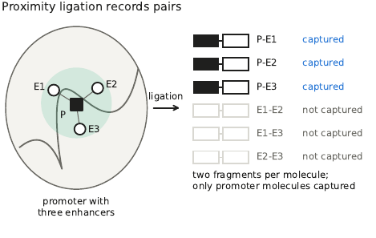
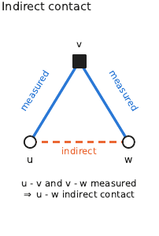
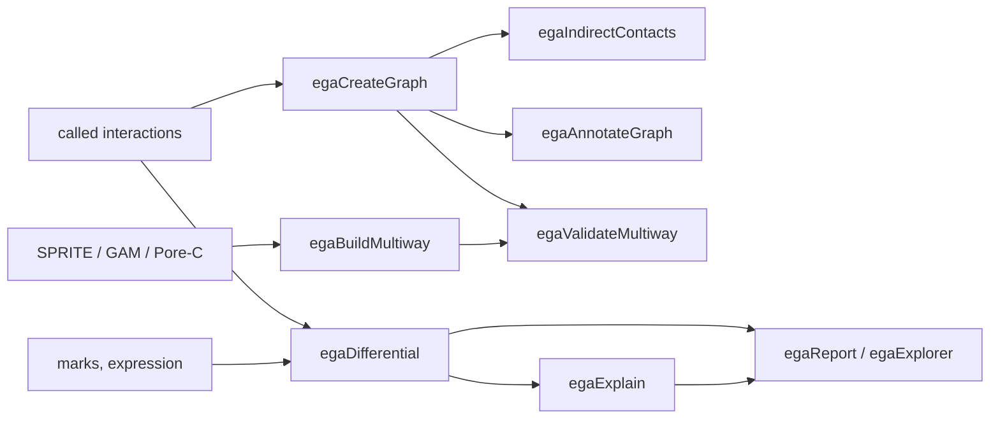
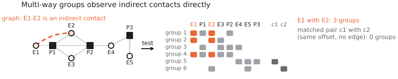

# Concepts

## Graph

Promoter capture Hi-C measures contacts between a baited promoter fragment and any other fragment. EGA turns the
called interactions into an undirected graph:

* **nodes** are restriction fragments (or bins), keyed by `chrom:start-end`. A fragment is a *bait* if it is captured,
  otherwise an *other end*. A baited fragment that is the other end of a promoter-promoter interaction is the same
  node as the bait, so paths can pass through promoters.
* **edges** are the called interactions, weighted by the score of the caller (`--weight score`), the read count or
  one.

Graphs of different conditions built on the same fragments share their nodes and can be compared edge by edge.

## Indirect contacts and steps

{ width="220" }

The **step** of a pair of nodes is the number of edges on the shortest path between them. One step is a measured
interaction; two steps are a pair connected through a shared neighbour, such as an enhancer E1 and an enhancer E2 that
both contact a promoter P (E1-P-E2). Promoter capture never measures such a pair of two other ends.

`egaIndirectContacts` lists the pairs at two steps with their mediators, the Adamic-Adar index and a path score, and
the two-step paths (triplets). A promoter together with all its direct partners is a **promoter hub**.

## Validation with multi-way data

SPRITE clusters, GAM tubes and Pore-C or HiPore-C concatemers record several loci of one nucleus together.
`egaValidateMultiway` compares every tested pair of graph nodes with control pairs at the identical offset, whose
ends are graph nodes of the same type, fall into the same coverage classes of the multi-way data and are not
connected within two steps. The result per step is the probability that a graph pair co-occurs more often than its
controls (0.5 without a relation). In the published data, this probability is above 0.5 for one to three steps and
reaches 0.5 at four to five steps. Two-step paths (triplets) and communities are tested against shifted controls.

## Explanation levels

For two conditions A and B, `egaDifferential` builds the union graph of the interactions called in either condition;
each edge is shared, gained or lost. For every differentially expressed gene, it then evaluates the levels in a fixed
order:

| Level | Question |
|---|---|
| `promoter_marks` | Do the marks at the promoter change in the direction expected from their role? |
| `promoter_contacts` | Do the promoter's own interactions change accordingly? |
| `promoter_state` | Does the promoter change from or to the bivalent state? |
| `step1_marks` | Do the marks at the fragments in direct contact change? |
| `step1_state` | Does a contacting fragment change its state? |
| `step2_marks`, `step3_marks` | Do the marks two or three steps away change? (`step2`, `step3` in the tables) |

A mark change is **concordant** when it is at least `--chromatinThreshold` (log2) in the direction of the role of the
mark and the expression change: an active mark rises with expression, a repressive mark falls.

At the steps, the marks of many nodes are combined into the contact-weighted signal: each node at step k
contributes its mark signal times the product of the edge strengths along the shortest paths from the promoter.
With `--stepFeature decomposed`, EGA separates the **mark term** (marks of A and B on edge strengths fixed at their
mean) from the **contact term** (edge strengths of A and B on marks fixed at their mean). The step levels use the
mark term.

## Controls of a single gene

* **Per-gene permutation test** (`--genePermutations`): the observed change against permuted signals on the same
  graph; *P* per gene and level, adjusted by Benjamini-Hochberg within the level (*q*).
* **Mirror control**: every node at the step is replaced by the interval at the same distance on the other side of
  the promoter. A change found at any locus of this distance is thereby recognised; `beyond_mirror` marks a change
  that exceeds the mirrored loci.
* **Threshold flags**: a gained or lost interaction is *stable* when its score in the other condition is below the
  floor, *threshold-sensitive* when it lies between the floor and the calling threshold, and *not testable* when the
  input of the other condition holds only called pairs.
* **Calibration with unchanged genes** (see [Calibration](usage/calibration.md)): the rate at which a level offers an
  explanation for genes whose expression does not change. Read every level against this rate.

## Mark roles and chromatin states

Roles are declared (`--markRoles H3K27ac=active H3K27me3=repressive`, roles `active`, `enhancer`, `repressive`,
`architectural`, `neutral`) or learned from the data per level (`--roles learned` or `both`). A fragment is
*bivalent* when an active-type and a repressive mark are present (fold enrichment at least `--stateThreshold`),
*active* or *repressed* with only one of them. Presence can also come from peak calls (`--statePeaksA/B`).

## What a report claims

A report lists, per gene and level, the observations and their support. It names candidate explanations; it does
not establish that a change causes the expression change. Co-activated neighbouring genes, for example, account for
the same observations. Perturbation experiments decide.
