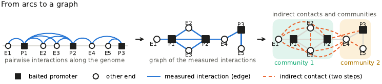

# Epigenetic Graph Analyzer

The **Epigenetic Graph Analyzer (EGA)** represents promoter capture Hi-C interactions as a graph of restriction
fragments, attaches chromatin marks, chromatin states and gene expression to it, and reports for every differentially
expressed gene which changes may account for its expression change: at the promoter, at its direct contacts and at
elements two or three steps away.



## Why EGA

- **Beyond the measured pairs.** Promoter capture Hi-C reads out pairs with a promoter. As a graph, the same contacts
  connect a promoter with elements two or three steps away, which capture never measures as a pair with it.
- **Checked against multi-way data.** SPRITE, GAM, Pore-C and HiPore-C show that graph neighbours occur together in
  single nuclei more often than control pairs, up to two to three steps.
- **One report per gene.** Every differentially expressed gene receives a report from the promoter to the indirectly
  connected elements, with a per-gene test, a mirror control, threshold flags and multi-way support.
- **Calibrated.** A comparison can be repeated with unchanged genes, which gives for every level the rate of
  explanations expected by chance.
- **For the analyst.** The reports list observations and their support. Which candidate to follow, for example in a
  perturbation experiment, is the decision of the analyst.

## At a glance

```bash
# install
mamba env create -f environment.yml && conda activate ega && pip install .

# graph of one condition and its indirect contacts
egaCreateGraph -i calls_washU.txt.gz -f washu --baits design.baitmap --tss genes.gtf.gz -o graphs/B
egaIndirectContacts -g graphs/B.graphml --triplets -o graphs/B

# two conditions, one report per gene
egaDifferential --interactionsA A.ibed --interactionsB B.ibed --tss genes.gtf.gz \
    --tracksA H3K27ac=A.bw --tracksB H3K27ac=B.bw --markRoles H3K27ac=active \
    --expression deseq2.tsv --log2FCColumn log2FoldChange --padjColumn padj -o differential/A_vs_B
egaReport -p differential/A_vs_B --gene GENE1 -o reports
egaExplorer -p differential/A_vs_B -o explorer/
```


## Where to go next

- [Installation](installation.md): conda, pip, checking the installation.
- [Tutorial](tutorial.md): a complete comparison on a small data set in 30 seconds.
- [Case study from A to Z](case_study.md): naive B cells against GM12878 from public data, with multi-way
  validation, reports, figures and calibration.
- [Concepts](concepts.md): graph, steps, explanation levels, controls.
- [Use cases](usage/differential.md) and the [command reference](reference/index.md).
- [Support and citation](support.md).
