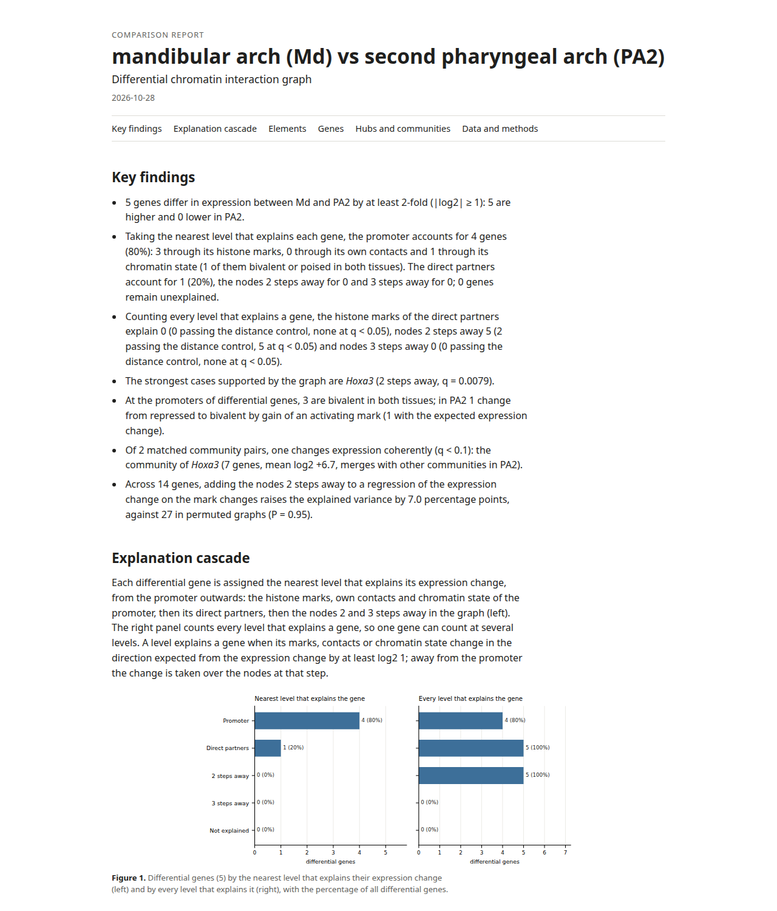
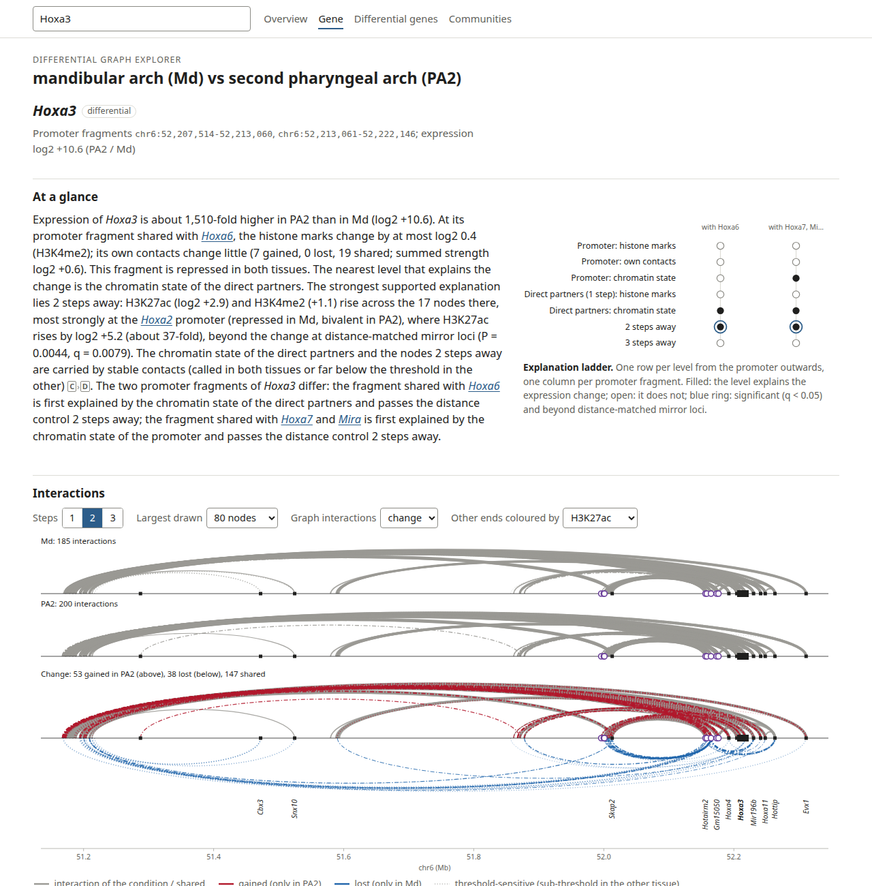

# Tutorial: a comparison from scratch

This tutorial runs a complete comparison of two conditions on a small public data set that ships with the
repository: the mouse E10.5 mandibular arch (Md) against the second pharyngeal arch (PA2) at the Hoxa locus
(chr6:49.5-54.5 Mb, mm10). In PA2, Hoxa2 is activated and gains contacts into a region that contains the enhancer
HIRE1 (Kessler et al. 2023). The inputs are cut out of the public data of Kessler et al. 2023 (promoter capture Hi-C,
GSE211902) and Minoux et al. 2017 (RNA-seq and ChIP-seq, GSE89434, GSE89435) by `example/prepare_example.py`.

The whole tutorial runs in about 30 seconds on one core with about 200 MB of memory:

```bash
bash example/run_example.sh example/output 2      # output directory, threads
```

The steps below are the commands of this script.

## Inputs

All inputs are in `example/data/` (2.2 MB):

| File | Content |
|---|---|
| `GSM6505208_*`, `GSM6505209_*` | CHiCAGO calls (WashU text) of two Md replicates |
| `GSM6505210_*`, `GSM6505211_*` | CHiCAGO calls of two PA2 replicates |
| `E10.5_{MD,PA2}_{H3K27ac,H3K4me2,H3K27me3}_R1.bigwig` | histone marks (signal tracks) |
| `{Md,PA2}_{H3K27ac,H3K4me2,H3K27me3}.fold.bw` | fold enrichment over input, used for the chromatin states |
| `deseq2_PA2_vs_Md.chr6_hoxa.tsv` | differential expression (DESeq2) of PA2 against Md |
| `mm10.ncbiRefSeq.chr6_hoxa.gtf.gz` | gene annotation |
| `PA2_25kb_{domains,boundaries}.bed`, `PA2_25kb_score.bedgraph` | domain calls of hicFindTADs on the PA2 Hi-C, for the reports |
| `kessler2023_HIRE_mm10.bed` | the named enhancer regions of Kessler et al. 2023 |

## 1. One graph per condition

```bash
cd example
md="data/GSM6505208_*.txt.gz data/GSM6505209_*.txt.gz"
pa2="data/GSM6505210_*.txt.gz data/GSM6505211_*.txt.gz"
egaCreateGraph -i $md -f washu --replicates intersect --tss data/mm10.ncbiRefSeq.chr6_hoxa.gtf.gz --geneTypes \
    --maxDistance 2000000 --weight score --communityMethod leiden --resolution 1.0 --seed 42 -o output/graphs/Md
egaCreateGraph -i $pa2 -f washu --replicates intersect --tss data/mm10.ncbiRefSeq.chr6_hoxa.gtf.gz --geneTypes \
    --maxDistance 2000000 --weight score --communityMethod leiden --resolution 1.0 --seed 42 -o output/graphs/PA2
```

`--replicates intersect` keeps the interactions called in both replicates. The graphs are written as GraphML with
node and edge tables (`<prefix>.graphml`, `_nodes.tsv`, `_edges.tsv`). Md has 139 fragments and 286 interactions,
PA2 170 and 345.

## 2. Comparison of the two conditions

```bash
egaDifferential --maxHops 3 --stepFeature decomposed --genePermutations 200000 \
    --rnaThreshold 1 --chromatinThreshold 1 --permutations 200 --bootstrap 1000 --seed 0 --threads 2 \
    --roles both --roleBootstrap 1000 --stateThreshold 2 --stateThresholds 1.5 2 3 --stateWindow 1000 \
    --interactionsA $md --interactionsB $pa2 \
    --format washu --replicates intersect --names Md PA2 \
    --tss data/mm10.ncbiRefSeq.chr6_hoxa.gtf.gz --geneTypes \
    --tracksA H3K27ac=data/E10.5_MD_H3K27ac_R1.bigwig H3K4me2=data/E10.5_MD_H3K4me2_R1.bigwig \
              H3K27me3=data/E10.5_MD_H3K27me3_R1.bigwig \
    --tracksB H3K27ac=data/E10.5_PA2_H3K27ac_R1.bigwig H3K4me2=data/E10.5_PA2_H3K4me2_R1.bigwig \
              H3K27me3=data/E10.5_PA2_H3K27me3_R1.bigwig \
    --stateTracksA H3K27ac=data/Md_H3K27ac.fold.bw H3K4me2=data/Md_H3K4me2.fold.bw H3K27me3=data/Md_H3K27me3.fold.bw \
    --stateTracksB H3K27ac=data/PA2_H3K27ac.fold.bw H3K4me2=data/PA2_H3K4me2.fold.bw H3K27me3=data/PA2_H3K27me3.fold.bw \
    --markSign H3K27me3=-1 --markRoles H3K27ac=active H3K4me2=active H3K27me3=repressive \
    --expression data/deseq2_PA2_vs_Md.chr6_hoxa.tsv --log2FCColumn log2FoldChange --padjColumn padj \
    --alpha 0.05 --geneKey genes -o output/Md_vs_PA2
```

What the options do:

* `--markRoles` declares the role of every mark (`active`, `enhancer`, `repressive`); `--markSign H3K27me3=-1` says
  that a loss of H3K27me3 goes with an increase of expression. `--roles both` also learns the roles from the data.
* `--stateTracksA/B` give the fold enrichment over input for the chromatin states (bivalent, active, repressed);
  without them the signal tracks are used.
* `--maxHops 3` evaluates the marks up to three steps from the promoter; `--stepFeature decomposed` separates the
  change of the marks from the change of the contacts.
* `--genePermutations` sets the permutations of the per-gene test; `--seed` makes the run reproducible.

The union graph of both conditions has 198 fragments and 417 interactions. The main outputs:

| File | Content |
|---|---|
| `Md_vs_PA2_explanation_levels.tsv` | per level, how many differentially expressed genes have a concordant observation |
| `Md_vs_PA2_explanations_all_levels.tsv` | every promoter fragment at every level, with the strongest node, *P*, *q* and a text |
| `Md_vs_PA2_explanation_cascade.tsv` | the first explaining level of every gene |
| `Md_vs_PA2_edges.tsv.gz` | the union edges, gained, lost or shared, with their threshold support |
| `Md_vs_PA2_union.graphml` | the annotated union graph |
| `Md_vs_PA2_mark_roles.tsv` | declared and learned mark roles |
| `Md_vs_PA2_state_transitions.tsv` | chromatin state transitions of the promoters |

## 3. Integrated tables

```bash
egaExplain -p output/Md_vs_PA2 -o output/explain/Md_vs_PA2
```

`egaExplain` joins interaction, chromatin and expression changes into tables per gene, element and community.

## 4. Reports

```bash
tads="--tads data/PA2_25kb --tadRegions data/kessler2023_HIRE_mm10.bed --tadMinStrength 0.5"
egaReport -p output/Md_vs_PA2 $tads --annotation data/mm10.ncbiRefSeq.chr6_hoxa.gtf.gz --pdf none -o output/reports
egaReport -p output/Md_vs_PA2 --gene Hoxa3 Hoxa2 $tads --annotation data/mm10.ncbiRefSeq.chr6_hoxa.gtf.gz \
    --pdf none -o output/reports
```

The first command writes the main report `Md_vs_PA2_report.html`, the second one report per gene
(`Md_vs_PA2_gene_Hoxa3.html`, `Md_vs_PA2_gene_Hoxa2.html`). Open them in a browser; they are self-contained.



*The main report: summary of the comparison, the explanation cascade and the genes explained at each level.*


*The gene report of Hoxa3: the text at the top says what changed at which level; the explanation ladder on the right
shows the levels from the promoter outwards (filled: explains; blue ring: beyond the mirrored loci with q < 0.05);
below, the interactions of both conditions and their change.*

## 5. Explorer and figures

```bash
egaExplorer -p output/Md_vs_PA2 --annotation data/mm10.ncbiRefSeq.chr6_hoxa.gtf.gz -o output/explorer/
egaPlotDifferential -g output/Md_vs_PA2_union.graphml --gene Hoxa3 --steps 2 \
    --candidates output/Md_vs_PA2_indirect_only_genes.tsv --mark H3K27ac -o output/hoxa3_differential.png
```

The explorer is one HTML file with a gene search; the address of a gene, for example `#gene=Hoxa3`, opens it
directly.



`egaPlotDifferential` draws the gained, lost and shared interactions around a gene as arcs and as a graph, with the
change of expression (squares) and of a mark (circles). Hoxa3 is outlined as a gene explained only beyond step 1, and
the Hoxa2 promoter, which gains H3K27ac, is ringed as an explaining node.


## 6. Reading the result

`Md_vs_PA2_explanations_all_levels.tsv` holds the levels of the two promoter fragments of Hoxa3 (log2 fold change
10.6 in PA2). Neither fragment changes its marks or its own interactions beyond the thresholds; the first is
repressed in both arches, the second bivalent in both arches (reported as poised). Two steps away, the Hoxa2 promoter gains H3K27ac (log2 change 5.2), and the step-2 level is concordant
beyond the mirrored loci (*P*=0.004, *q*=0.008). The report of Hoxa3 therefore names the Hoxa2 promoter region as
a candidate explanation, reached through the shared contacts of the cluster. Hoxa2 is itself induced in PA2, so an
activation of both genes by one programme accounts for the same observation; the report offers the path, and an
experiment decides.

The report of Hoxa2 shows the gained contacts across the domain boundary into the HIRE1 region.

## 7. Check against the expected results

```bash
python summarize_example.py output output/summary
diff -r expected output/summary && echo identical
```

## Next steps

* [Concepts](concepts.md): graph, explanation levels, controls.
* [Two conditions](usage/differential.md): all options of a comparison and how to choose them.
* [Calibration](usage/calibration.md): the rate of explanations for genes whose expression does not change.
