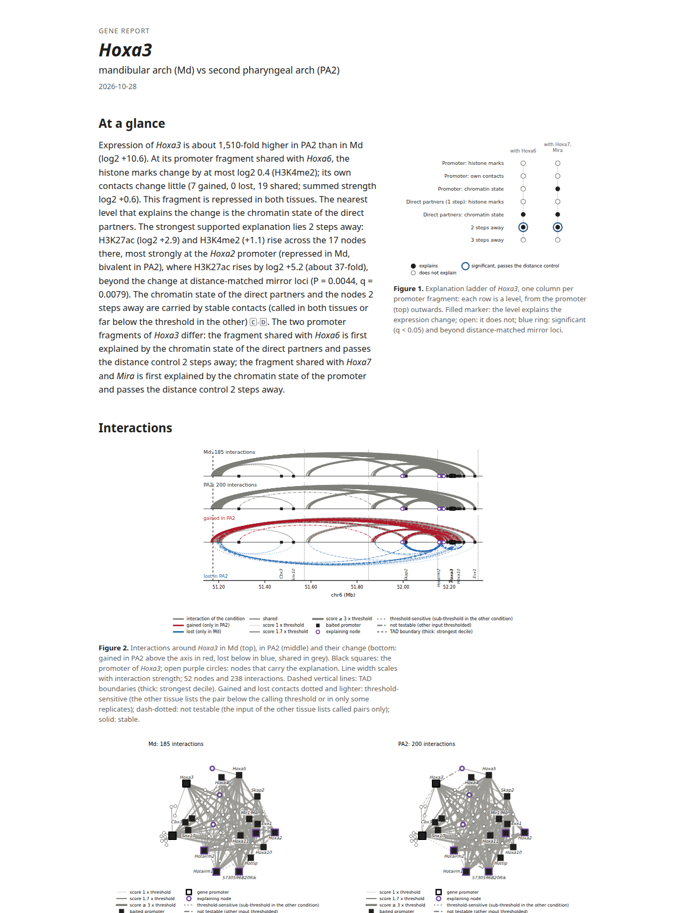
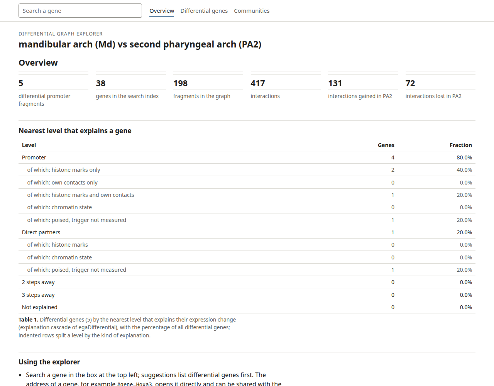
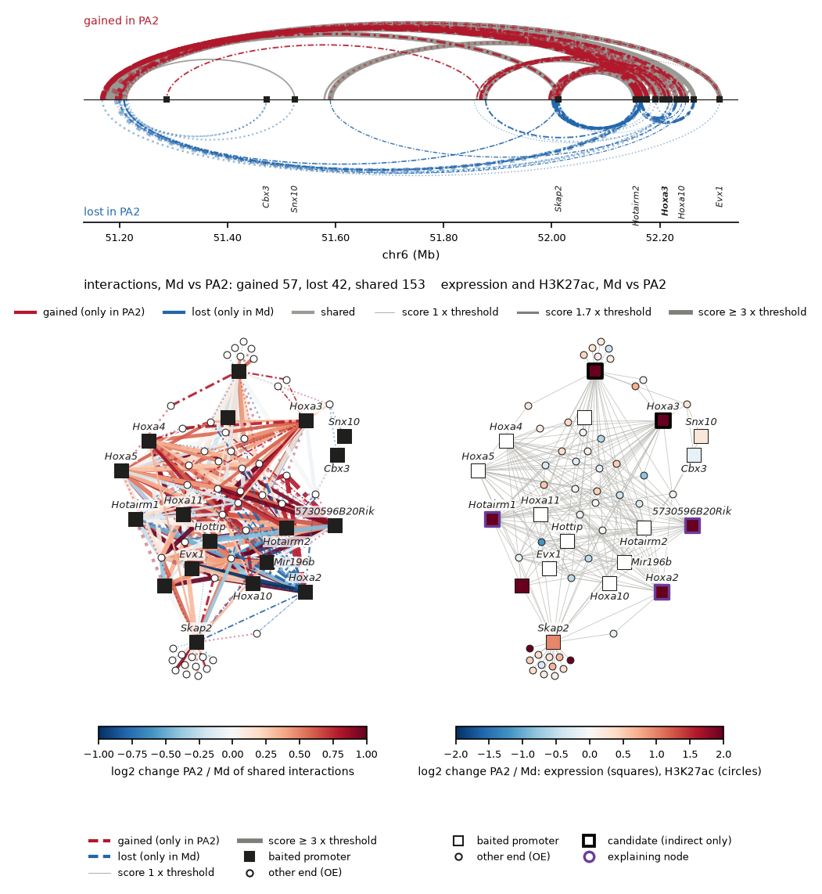

# Reports, explorer and plots

All three read the output prefix of `egaDifferential` and, if present, the tables of `egaExplain`.

## Reports

```bash
# main report: summary, explanation cascade, major findings, hubs and communities, methods
egaReport -p differential/A_vs_B --annotation genes.gtf.gz -o reports

# one report per gene
egaReport -p differential/A_vs_B --gene GENE1 GENE2 --annotation genes.gtf.gz -o reports

# one community
egaReport -p differential/A_vs_B --community 12 --communitySide B -o reports
```

A gene report shows, level by level, what changed at the promoter, at its direct contacts and two and three steps
away, with the strongest nodes, *P*, *q*, the mirror control, the threshold flags and a drawing of the neighbourhood
in both conditions.



Options:

* `--overlay` adds the inputs as tracks (interactions per condition, mark tracks, expression) for the region of the
  gene.
* `--tads`, `--tadRegions` add the domain boundaries crossed by gained and lost contacts.
* `--pdf auto|chromium|matplotlib|none` chooses the PDF engine; HTML is always written.
* `--labels` gives readable condition names for the titles.

## Explorer

```bash
egaExplorer -p differential/A_vs_B --annotation genes.gtf.gz -o explorer/
```

One self-contained HTML file that works offline: gene search with the text of the reports, arcs and neighbourhood
graph per gene, and lists of the differentially expressed genes and communities. `--differentialOnly` limits the
search to the differentially expressed genes.



## Figures of a comparison

```bash
# a gene and its neighbourhood up to the explaining step, gained / lost / shared arcs and the mark changes
egaPlotDifferential -g differential/A_vs_B_union.graphml --gene GENE1 --steps 2 \
    --candidates differential/A_vs_B_indirect_only_genes.tsv --sideBySide -o figures/GENE1.pdf

# a region, one panel per file for assembly in a manuscript
egaPlotDifferential -g differential/A_vs_B_union.graphml --region chr6:51000000-52500000 \
    --separatePanels -o figures/region.pdf
```

The format follows the file extension (pdf, svg, eps or png, jpg, tif with `--dpi`).


